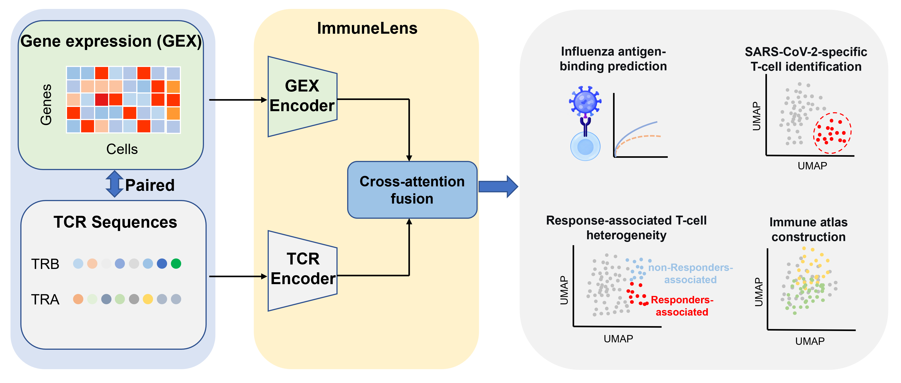

# ImmuneLens

ImmuneLens is a multimodal representation learning framework that fuses paired single-cell gene expression (GEX) and TCR data via cross-attention and shared/private variational representations. It predicts antigen binding for unseen clonotypes, reveals antigen- and immunotherapy-associated T-cell heterogeneity, and supports multi-cohort immune atlas construction and external data projection.

<p align="center">
  
</p>

## Project layout

```text
immunelens/
├── models/model.py                         # shared RNA encoder, decoders, cross-attention
├── preprocessing/
│   ├── influenza_binder_tables.py          # task 1: build clone-disjoint binder tables
│   ├── influenza_binder_data.py            # task 1: validate splits, select train-only RNA genes
│   ├── antigen_binding_data.py             # task 2: load paired ECCITE cells and expression
│   ├── luad_immunotherapy_data.py          # task 3: join NSCLC RNA, TCR and clinical metadata
│   └── sequences.py                        # shared paired-TCR sequence cleaning
├── training/
│   ├── influenza_binder_prediction.py      # task 1: influenza binder prediction
│   ├── antigen_binding_representation.py   # task 2: antigen-binding representations
│   ├── luad_immunotherapy_subclusters.py   # task 3: LUAD ICB RNA-TCR representations
│   └── immune_atlas.py                     # task 4: immune atlas training
└── analysis/
    ├── antigen_binding_figures.py          # task 2: ECCITE embedding plots
    ├── antigen_binding_heldout_donors.py   # task 2: held-out-donor clone retrieval
    ├── luad_subcluster_analysis.py         # task 3: fused substate analysis
    └── atlas_projection.py                 # task 4: project BCC cells into the atlas
```

The antigen-binding and LUAD immunotherapy training scripts retain identical task-specific `FusedModel` definitions. The influenza script has a modified decoder and a binder classifier. Shared lower-level model classes are imported from `immunelens.models.model` instead of being copied across scripts. Data loading and validation have been moved into `preprocessing`; task-specific training and analysis stay in their own modules.

## Install

Use Python 3.10 or newer in a fresh environment. Install a PyTorch build suited to the machine, then install this package:

```bash
python -m pip install -e .
```

Optional TCRdist regularization for the antigen-binding training workflow requires `python -m pip install -e '.[tcrdist]'`. Pretrained TCR-BERT weights and input datasets are external; they are not distributed here. Run the commands below from the repository root. Set `CUDA_DEVICE` or each script's `--device`/`--cuda` option to a device available on your machine.

## Workflows

### 1. Influenza antigen-binding prediction for unseen TCR clonotypes

The preprocessing input must contain `donor1/epi.csv`, `donor1/rna.h5ad`, `donor2/epi.csv`, and `donor2/rna.h5ad`. Each `epi.csv` needs `barcode`, `cell_clono_cdr3_aa`, and the antigen-specific binder column. The builder creates clone-disjoint train/validation/test tables; the training script predicts measured cell-level binder calls.

```bash
export IMMUNELENS_TCRBERT_DIR=<tcrbert-checkpoint-dir>
python -m immunelens.preprocessing.influenza_binder_tables --data-dir <10x-dir> --out-dir <binder-data-dir>
python -m immunelens.training.influenza_binder_prediction --dataset-dir <binder-data-dir> --rna-dir <10x-dir> --out-dir <binder-results-dir> --task all --mode all
```

### 2. Multimodal joint representations reveal heterogeneity in antigen-binding T cells

The input is the processed vaccine ECCITE-seq H5AD expected by the scripts, including paired TRA/TRB and measured dextramer annotations. Dextramer calls are used for evaluation, not representation training. The held-out-donor analysis scores clone retrieval across donors; it does not train a supervised antigen classifier.

```bash
python -m immunelens.training.antigen_binding_representation --data <eccite.h5ad> --tcrbert_dir <tcrbert-dir> --out_dir <virus-results-dir>
python -m immunelens.analysis.antigen_binding_figures --input <virus-results-dir>/virus_unsupervised_embeddings.h5ad --expression_data <eccite.h5ad> --out_dir <virus-figures-dir>
python -m immunelens.analysis.antigen_binding_heldout_donors --data <eccite.h5ad> --tcrbert_dir <tcrbert-dir> --out_dir <virus-lodo-dir>
```

### 3. T cell subcluster heterogeneity associated with immunotherapy response

Provide NSCLC expression, cell metadata, TCR annotations, sample response metadata, and TCR-BERT weights through environment variables. The training output H5AD feeds the substate analysis.

```bash
export IMMUNELENS_LUAD_RNA=<nsclc.h5ad>
export IMMUNELENS_LUAD_META=<nsclc-cell-metadata.csv>
export IMMUNELENS_LUAD_TCR=<tcr-annotations.csv>
export IMMUNELENS_LUAD_SAMPLE_META=<sample-response.csv>
export IMMUNELENS_TCRBERT_DIR=<tcrbert-checkpoint-dir>
export IMMUNELENS_LUAD_OUT=results/luadvae
python -m immunelens.training.luad_immunotherapy_subclusters
python -m immunelens.analysis.luad_subcluster_analysis --h5ad results/luadvae/adata_nsclc_icb.h5ad --out_dir results/luad-substates
```

### 4. Multi-cohort immune reference atlas and external data projection

The atlas combines CRC, NSCLC, and COVID expression and metadata. The query stage reads the saved reference assets plus BCC expression and metadata.

```bash
python -m immunelens.training.immune_atlas --crc-h5ad <crc.h5ad> --crc-meta <crc.tsv> --ns-h5ad <nsclc.h5ad> --ns-meta <nsclc.csv> --covid-h5ad <covid.h5ad> --covid-meta <covid.csv> --save-dir <atlas-dir> --device <device>
python -m immunelens.analysis.atlas_projection --ref-dir <atlas-dir> --bcc-h5ad <bcc.h5ad> --bcc-meta <bcc-meta.txt> --save-dir <query-dir> --device <device>
```

## Data and release notes

Every input and output path can be set on the command line. Defaults fall back to repository-relative locations (`data/`, `results/`, `models/`) and can be overridden with environment variables:

| Variable | Meaning |
| --- | --- |
| `IMMUNELENS_TCRBERT_DIR` | TCR-BERT checkpoint directory |
| `IMMUNELENS_EPIBIND_RNA_DIR` | 10x influenza input directory |
| `IMMUNELENS_EPIBIND_DATASET_DIR` | clone-disjoint binder tables |
| `IMMUNELENS_EPIBIND_OUT_DIR` | binder training output |
| `IMMUNELENS_ECCITE_DATA` | processed ECCITE-seq H5AD |
| `IMMUNELENS_LUAD_RNA`, `IMMUNELENS_LUAD_META`, `IMMUNELENS_LUAD_TCR`, `IMMUNELENS_LUAD_SAMPLE_META`, `IMMUNELENS_LUAD_OUT` | LUAD inputs and output |
| `IMMUNELENS_CRC_RNA`, `IMMUNELENS_CRC_META` | atlas CRC inputs |
| `IMMUNELENS_NSCLC_RNA`, `IMMUNELENS_NSCLC_META` | atlas NSCLC inputs |
| `IMMUNELENS_COVID_RNA`, `IMMUNELENS_COVID_META` | atlas COVID inputs |

Large data files, pretrained weights, checkpoints, and results are excluded through `.gitignore`; keep them outside the Git repository. No software license is included because reuse terms have not been specified.
